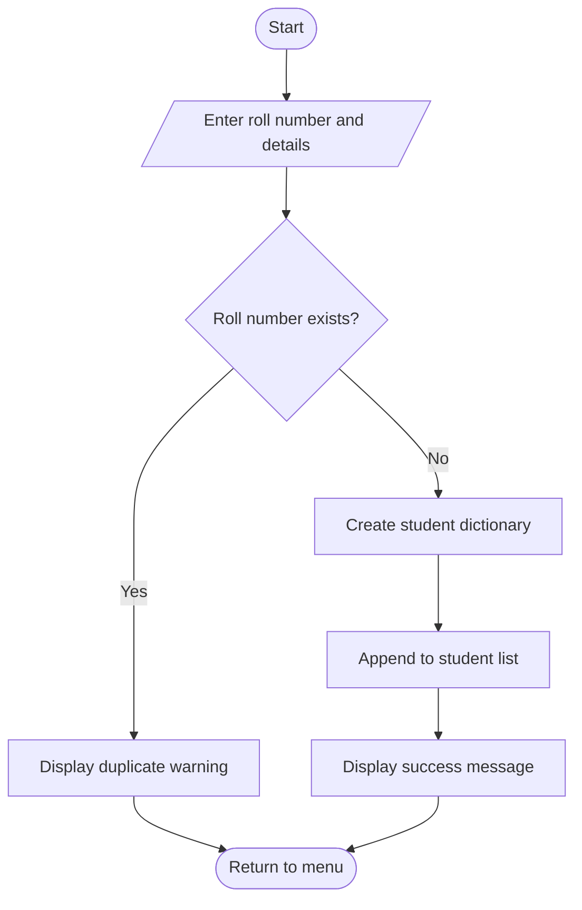
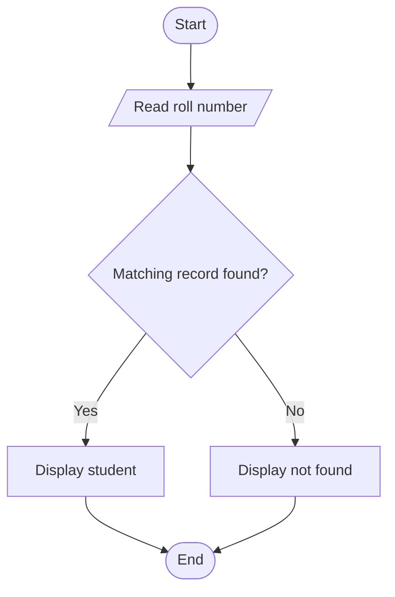
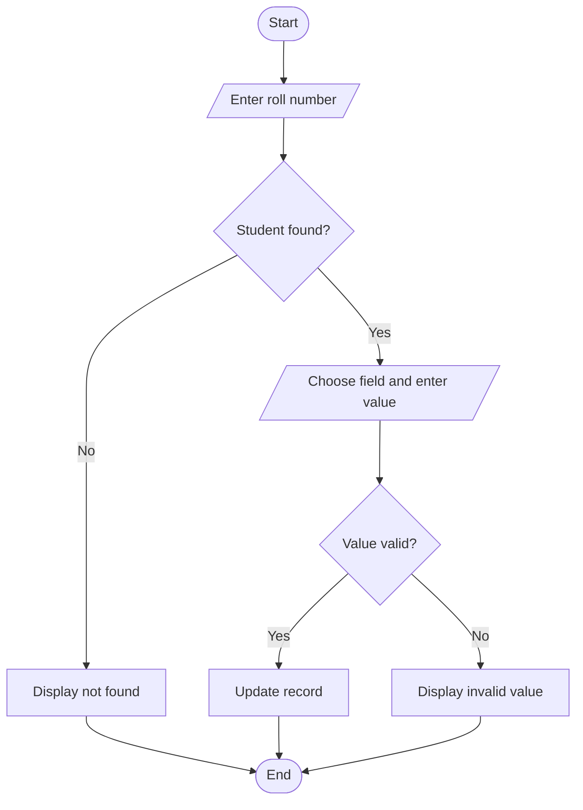
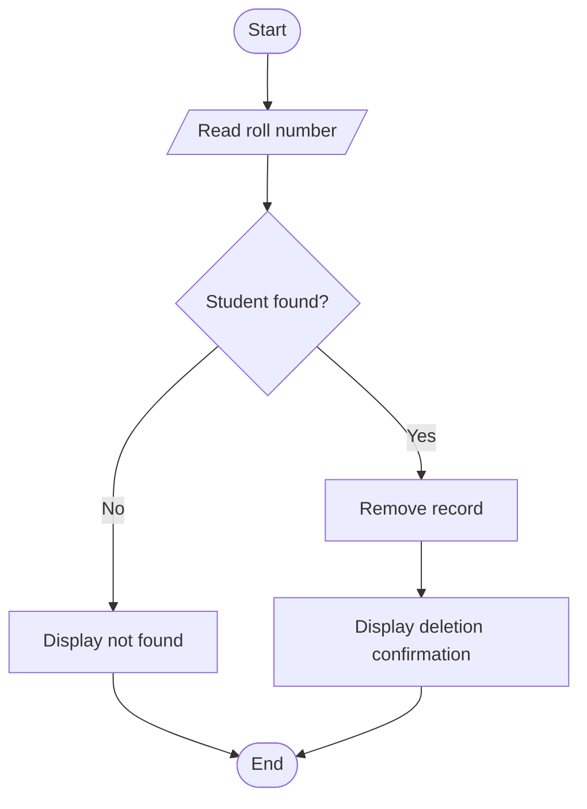
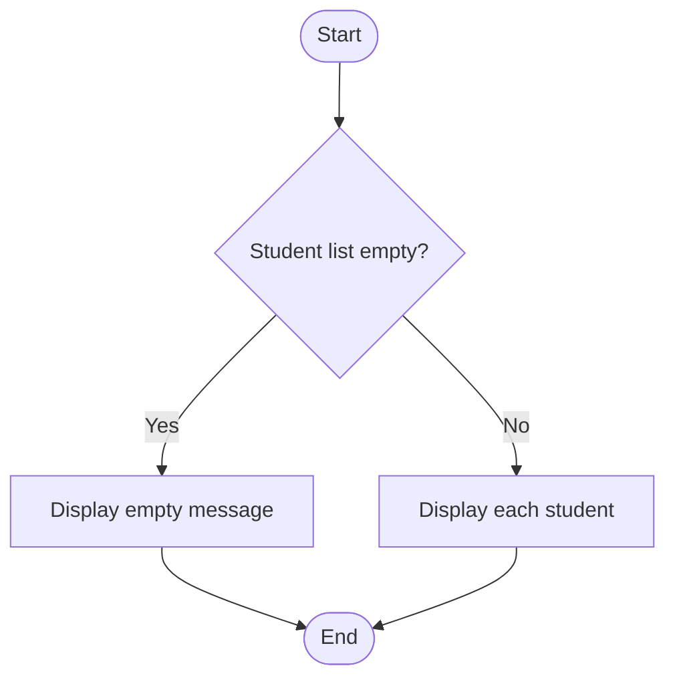

# Algorithms, Pseudocode, and Flowcharts
**Project:** Student Record and Academic Management System  
**PRN:** 2126UMLM1123

## 1. Add Student
### Algorithm
1. Read the roll number.
2. Search existing student records for the same roll number.
3. If it exists, show a duplicate warning and stop this operation.
4. Otherwise, read the student's remaining details.
5. Create a dictionary and append it to the student list.
6. Display confirmation.

### Pseudocode
```text
START
READ roll_number
IF roll_number is empty THEN
    DISPLAY "Roll number cannot be empty"
    STOP operation
END IF
FOR EACH student IN students
    IF student.roll_no = roll_number THEN
        DISPLAY "Student already exists"
        STOP operation
    END IF
END FOR
READ student details
CREATE student dictionary
APPEND dictionary TO students
DISPLAY "Student added successfully"
STOP
```

### Flowchart (Mermaid)


## 2. Search Student
### Algorithm
1. Read the roll number to search.
2. Compare it with each student record.
3. If a match is found, display the record.
4. Otherwise, display “Student not found.”

### Pseudocode
```text
START
READ roll_number
SET found = FALSE
FOR EACH student IN students
    IF student.roll_no = roll_number THEN
        DISPLAY student
        SET found = TRUE
        EXIT LOOP
    END IF
END FOR
IF found = FALSE THEN
    DISPLAY "Student not found"
END IF
STOP
```

### Flowchart


## 3. Update Student
### Algorithm
1. Read the roll number.
2. Search for the matching record.
3. If missing, display a not-found message.
4. If found, ask which supported field to update.
5. Validate the new value where needed and save it.
6. Display the result.

### Pseudocode
```text
START
READ roll_number
FIND student with roll_number
IF student does not exist THEN
    DISPLAY "Student not found"
ELSE
    DISPLAY updateable fields
    READ field and new_value
    VALIDATE new_value
    IF valid THEN
        UPDATE selected field
        DISPLAY "Student record updated"
    ELSE
        DISPLAY "Invalid value"
    END IF
END IF
STOP
```

### Flowchart


## 4. Delete Student
### Algorithm
1. Read the roll number.
2. Search for the record.
3. If found, remove the record from the list.
4. Otherwise, display a not-found message.

### Pseudocode
```text
START
READ roll_number
FIND student
IF student exists THEN
    REMOVE student from students
    DISPLAY "Student record deleted"
ELSE
    DISPLAY "Student not found"
END IF
STOP
```

### Flowchart


## 5. Display All Students
### Algorithm
1. Check whether the student list is empty.
2. If empty, display a message.
3. Otherwise, loop through each student and display the profile.

### Pseudocode
```text
START
IF students is empty THEN
    DISPLAY "No student records available"
ELSE
    FOR EACH student IN students
        DISPLAY student details
    END FOR
END IF
STOP
```

### Flowchart


## 6. Calculate Average Marks
### Algorithm
1. Read a roll number and find the student.
2. If not found, display a message.
3. If there are no marks, explain that no average is available.
4. Otherwise, add the marks and divide by their count.
5. Display the average.

### Pseudocode
```text
START
READ roll_number
FIND student
IF student does not exist THEN
    DISPLAY "Student not found"
ELSE IF marks list is empty THEN
    DISPLAY "No marks available"
ELSE
    SET total = sum of marks
    SET average = total / number of marks
    DISPLAY average
END IF
STOP
```

## 7. Find Highest Scorer
### Algorithm
1. Select students whose marks list is not empty.
2. If there are none, display a message.
3. Calculate each student's average.
4. Select the student with the highest average.
5. Display the student and average.

### Pseudocode
```text
START
SET scored_students = students with at least one mark
IF scored_students is empty THEN
    DISPLAY "No marks available"
ELSE
    SET highest = first scored student
    FOR EACH student IN scored_students
        IF student average > highest average THEN
            SET highest = student
        END IF
    END FOR
    DISPLAY highest student and average
END IF
STOP
```

## 8. List Students by Department
### Algorithm
1. Read a department name.
2. Compare it with each student's department, ignoring case.
3. Display matching students.
4. If no match exists, display a message.

### Pseudocode
```text
START
READ department
SET matches = empty list
FOR EACH student IN students
    IF student department matches department THEN
        APPEND student TO matches
    END IF
END FOR
IF matches is empty THEN
    DISPLAY "No students found"
ELSE
    DISPLAY matches
END IF
STOP
```

## 9. Count Students
```text
START
SET total = number of records in students
DISPLAY total
STOP
```

## 10. Show Unique Data
```text
START
CREATE a set of all non-empty departments
CREATE a set of all subjects
CREATE a set of all clubs
DISPLAY each set in sorted order
STOP
```
